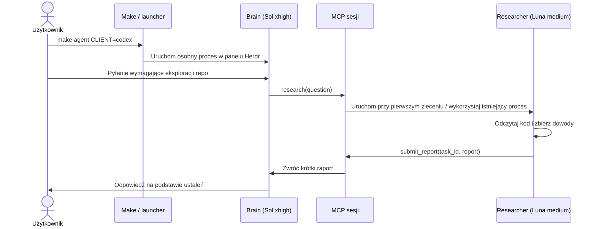

# Opcjonalna sesja Brain + Researcher

Ten tryb dotyczy wyłącznie pracy z checkoutem `ai-profiles`. Włącza się go
jawną komendą Make. Zwykłe `codex`, `claude`, instalacja profilu i pozostałe
polecenia repozytorium nie uruchamiają tego workflow. Nie zmieniamy `AGENTS.md`,
globalnej konfiguracji klientów ani dystrybuowanych profili/skilli/MCP.

## Zakres i wybór sposobu pracy

Repozytorium pozostaje zestawem narzędzi i zasobów do pracy. Opisany tutaj
workflow jest jedną z dostępnych opcji, wybieraną dla konkretnej sesji.
Nie stanowi obowiązkowego sposobu rozwijania `ai-profiles`.

| Sposób uruchomienia | Zachowanie |
| --- | --- |
| `codex` | Zwykła sesja klienta z dotychczasową konfiguracją; bez automatycznej aktywacji opisanego workflow |
| `claude` | Zwykła sesja Claude; obecne wdrożenie nie dodaje integracji tego klienta |
| `make agent CLIENT=codex` | Nowy Brain w Herdr z możliwością automatycznego zlecania eksploracji Researcherowi |
| `make install CLIENT=… PROFILE=… PROJECT=…` | Dotychczasowa instalacja zasobów profilu; nie uruchamia sesji Brain + Researcher |

Obecnie obsługiwany jest wyłącznie `CLIENT=codex`. Parametry `PROFILE` i
`PROJECT` nie wybierają zasobów ani katalogu pracy tego workflow. Launcher
korzysta z checkoutu `ai-profiles`, w którym znajduje się jego binarium.
Wydzielenie mechanizmu do zasobów dostarczanych innym projektom pozostaje
możliwym przyszłym rozszerzeniem.

## Role i odpowiedzialności

**Brain** prowadzi rozmowę z użytkownikiem, interpretuje zadanie i podejmuje
decyzje. Może analizować, planować oraz implementować zmiany zlecone przez
użytkownika. Przy szerszej eksploracji kodu zleca Researcherowi zebranie dowodów,
a następnie wykorzystuje raport do przygotowania odpowiedzi lub dalszej pracy.

**Researcher** wyszukuje pliki, symbole i miejsca użycia, śledzi przepływy danych
oraz opisuje zależności. Zwraca krótkie ustalenia z odnośnikami do kodu.
Nie implementuje zmian, nie uruchamia testów i nie podejmuje decyzji
architektonicznych. Jego ograniczenie do odczytu obejmuje polecenia wykonywane
w sandboxie Codexa; raport zapisuje osobne narzędzie MCP poza repozytorium.

**Herdr** zarządza panelami i osobnymi procesami Codexa. **Launcher** tworzy
te procesy, przekazuje konfigurację i koordynuje zadania oraz raporty. Są to
rzeczywiste procesy, a nie natywne subagenty jednej rozmowy Codexa.

## Przebieg jednej sesji



Samo uruchomienie Braina nie tworzy jeszcze Researchera. Dopiero wywołanie
`research` powoduje sprawdzenie stanu workera i ewentualne utworzenie kolejnego
panelu. Przed wysłaniem pytania launcher zapisuje identyfikator zadania.
Researcher otrzymuje pytanie i `task_id`, a po analizie przekazuje raport
narzędziem `submit_report`.

Przy następnym pytaniu wymagającym eksploracji Brain ponownie wywołuje
`research`. Launcher wykorzystuje istniejącego Researchera, o ile jest gotowy
i nie osiągnął limitu zadań. Historia narzędzi Researchera pozostaje w jego
sesji; przez narzędzie delegacji do Braina trafia raport.

## Uruchomienie

W terminalu **wewnątrz uruchomionego Herdr**, z katalogu tego repozytorium:

```sh
make agent CLIENT=codex
```

Wymagania: Linux, Rust/Cargo jak dla pozostałych komend produkcyjnych repo,
zalogowany Codex CLI i działający Herdr z `agent start/prompt/get`, `pane split`,
metadanymi `terminal_id` oraz `pane layout`. Wdrożenie sprawdzano z Codex
0.164.0 i Herdr 0.9.5. Nie instalujemy klientów ani nie zatwierdzamy za użytkownika
ich okien logowania, zaufania projektu czy uprawnień. Poza Herdr polecenie
odmawia działania; nie uruchamia zagnieżdżonego multipleksera.

Polecenie buduje natywny launcher, tworzy sąsiedni panel z Brainem i drukuje
`SESSION=/tmp/ai-profiles-agents-…` oraz JSON stanu. Fokus pozostaje w terminalu
wywołującym. Przełącz się do wskazanego panelu Brain i rozmawiaj z nim normalnie,
np. „Znajdź punkt wejścia narzędzia i prześledź instalację profilu”.

Brain dostaje tylko dla tej sesji instrukcje delegowania szerszej eksploracji
repo. Pojedynczy znany plik może przeczytać sam. Researcher uruchamia się przy
pierwszym wywołaniu narzędzia `research`, w kolejnym panelu Herdr. Kolejne
zlecenia wykorzystują ten sam proces. Brain nie musi być agentem ze skilla
`brain-to-implementer`; ta nazwa oznacza tu rolę prowadzącą rozmowę.

Przykładowe polecenie do Braina:

> Prześledź instalację profilu dla Codexa. Wskaż, gdzie wybierane są skille,
> jak powstaje zestaw plików i gdzie zapisywany jest stan. Tylko analiza,
> bez modyfikowania plików.

Nie trzeba osobno uruchamiać Researchera ani przeklejać między panelami jego
wyników. Odczyt jednego znanego pliku lub sprawdzenie konkretnego odnośnika
może wykonać sam Brain. Instrukcje sesji zalecają delegowanie szerszego skanu,
ale rozpoznanie takiej potrzeby pozostaje zachowaniem modelu.

## Modele i limity

```sh
make agent CLIENT=codex \
  BRAIN_MODEL=gpt-6.1-sol BRAIN_THINKING=xhigh \
  RESEARCHER_MODEL=gpt-6-luna RESEARCHER_THINKING=medium \
  RESEARCH_TIMEOUT=180 RESEARCHER_MAX_TASKS=8
```

To są ustawienia domyślne. Thinking: `low`, `medium`, `high`, `xhigh`, `max`;
wybrany model musi wspierać ustawienie i być dostępny dla konta. `ultra` jest
wyłączone, ponieważ może włączać natywną delegację. Launcher nie wybiera
zastępczego modelu przy błędzie dostępu. Modele/limity zmienia się przez nowe
uruchomienie; nie edytuj ręcznie `state.json` aktywnej sesji.

| Parametr Make | Domyślnie | Znaczenie |
| --- | --- | --- |
| `CLIENT` | Wymagany: `codex` | Klient uruchamiany w obu rolach |
| `BRAIN_MODEL` | `gpt-6.1-sol` | Model prowadzący rozmowę i rozumowanie |
| `BRAIN_THINKING` | `xhigh` | Poziom reasoning Braina |
| `RESEARCHER_MODEL` | `gpt-6-luna` | Model eksplorujący repozytorium |
| `RESEARCHER_THINKING` | `medium` | Poziom reasoning Researchera |
| `RESEARCH_TIMEOUT` | `180` | Limit oczekiwania na zadanie Researchera, w sekundach; zakres 5–1800 |
| `RESEARCHER_MAX_TASKS` | `8` | Limit zadań przed odtworzeniem procesu Researchera; zakres 1–100 |
| `SESSION` | Brak | Ścieżka istniejącej sesji, wymagana przez `agent-status` i `agent-stop` |

Przykład zmiany samego poziomu reasoning Researchera:

```sh
make agent CLIENT=codex RESEARCHER_THINKING=low
```

Zmiana parametrów dotyczy nowo uruchamianej sesji. Nie przełącza modeli
w już działających panelach. Wartości pokazane przez launcher opisują żądaną
konfigurację; dostępność modelu oraz obsługę ustawienia weryfikuje klient.
Nie ma automatycznego zastępowania niedostępnego modelu innym.

Jedna sesja ma maksymalnie jednego Researchera i jedno aktywne zadanie. Blokada
plikowa odrzuca równoległe zlecenie zamiast wysłać je do zajętego procesu.
Po 8 wysłanych i zakończonych raportem zadaniach kolejny research zamyka
własny panel Researchera i tworzy nowy kontekst. Limit można ustawić na 1–100;
timeout wynosi 5–1800 sekund. Osobne jawne uruchomienia tworzą niezależne sesje,
procesy i katalogi wyników, nawet dla tego samego checkoutu.

Limit dotyczy Researchera, nie kontekstu Braina. Odtworzenie workera nie
czyści rozmowy Braina. Nie ma również wspólnego, globalnego limitu procesów
obejmującego wszystkie niezależne wywołania `make agent`.

## Uprawnienia i raporty

Brain działa z `workspace-write` i `on-request`. Researcher ma `read-only`
i `never`: nie może uzyskać eskalacji poleceń. Oba procesy mają wyłączone natywne
subagenty. Researcher ma ponadto wyłączone Apps, pluginy, hooks, przeglądarkę,
wyszukiwanie internetowe oraz skonfigurowane wcześniej serwery MCP. Efektywny
inwentarz MCP jest odczytywany przed każdym tworzeniem Researchera. Zachowaj
konfigurację klienta niezmienioną podczas życia procesu; po jej zmianie uruchom
nową sesję. Domyślne narzędzia odczytu plików działają w sandboxie Codexa.

### Co oznacza prawo zapisu Braina

**Ten workflow nie jest w całości trybem tylko do odczytu.** Brain ma
`workspace-write`, ponieważ ma móc realizować także zlecenia implementacyjne.
`on-request` określa sposób proszenia o eskalację; nie wymaga osobnego
potwierdzenia każdej edycji dozwolonej przez sandbox.

Polecenie „tylko analiza, bez zmian” ogranicza zadanie Braina na poziomie
instrukcji. Nie zmienia jego sandboxa na `read-only`. Techniczna blokada
zapisu dotyczy Researchera. Obecny interfejs Make nie udostępnia parametru
przełączającego sandbox Braina na tryb tylko do odczytu.

Serwer MCP jest osobnym procesem. Sandbox poleceń Researchera nie stanowi
ogólnego ograniczenia uprawnień serwera MCP; dlatego jego interfejs dla tej
roli udostępnia tylko zapis raportu do katalogu bieżącej sesji. Nie udostępnia
narzędzia edytowania plików projektu ani uruchamiania kolejnych agentów.

Launcher uruchamia tymczasowy serwer MCP `ai_profiles_session` jako osobny
proces stdio. Nie rejestruje go w konfiguracji projektu/użytkownika. Zajęta
nazwa serwera blokuje start bez nadpisywania konfiguracji.

Brain otrzymuje narzędzia `research`, `research_status`, `reset_researcher`.
Researcher otrzymuje tylko `submit_report`. To ostatnie zapisuje raport w
prywatnym katalogu sesji poza repozytorium, bez przyznawania shellowi praw zapisu.
Raport wymaga pięciu niepustych sekcji: `SUMMARY`, `RELEVANT FILES`,
`EXECUTION FLOW`, `IMPORTANT FINDINGS`, `UNCERTAINTIES`. Docelowa długość to
800–1200 tokenów lub mniej; twardy limit to 8000 bajtów UTF-8, nie pomiar tokenów.

Brain otrzymuje raport, identyfikator zadania i konfigurację modelu Researchera.
Launcher nie czyta terminalowej historii skanowania. Raporty są danymi;
nie zmieniają instrukcji ani uprawnień Braina. Dowody istotne dla decyzji nadal
wymagają oceny, a w razie potrzeby sprawdzenia wskazanego pliku.

### Narzędzia dostępne w rolach

| Rola | Narzędzie MCP | Działanie |
| --- | --- | --- |
| Brain | `research` | Wysyła nowe pytanie do Researchera i oczekuje na raport |
| Brain | `research_status` | Odczytuje gotowy raport albo stan ostatniego zadania bez ponownej wysyłki |
| Brain | `reset_researcher` | Zamyka workera i usuwa wskazanie bieżącego zadania; wymaga `confirm_cancel=true` |
| Researcher | `submit_report` | Przekazuje raport dla zgodnego `task_id`; nie nadpisuje istniejącego raportu |

`reset_researcher` jest operacją anulowania, a nie sposobem zwykłego oczekiwania
na wynik. Instrukcje Braina wymagają jawnego zlecenia resetu przez użytkownika.
Sam argument `confirm_cancel=true` jest parametrem narzędzia, nie osobnym
oknem zatwierdzania przez człowieka.

### Format raportu

```text
SUMMARY
Krótka odpowiedź na zlecone pytanie.

RELEVANT FILES
core/src/bin/ai-profile.rs:6 — punkt wejścia CLI.

EXECUTION FLOW
Zwięzła kolejność wywołań i najważniejsze zależności.

IMPORTANT FINDINGS
Ustalenia istotne dla odpowiedzi lub dalszych decyzji.

UNCERTAINTIES
Czego nie potwierdzono albo jakie są granice analizy.
```

Walidator sprawdza identyfikator zadania, rozmiar, kolejność nagłówków i obecność
treści w sekcjach. Nie sprawdza automatycznie prawdziwości ustaleń ani tego,
czy wskazany numer linii rzeczywiście potwierdza wniosek. To pozostaje częścią
oceny raportu przez Braina i użytkownika.

## Pliki i trwałość sesji

Każde uruchomienie tworzy prywatny katalog tymczasowy. Zwykle znajduje się
on pod `/tmp/ai-profiles-agents-…`; faktyczną lokalizację wskazuje `SESSION`
w wyniku polecenia i może na nią wpływać środowisko katalogów tymczasowych.

```text
ai-profiles-agents-XXXXXX/
├── state.json
├── worker.lock
├── task-1.report.json
└── task-2.report.json
```

| Plik | Zawartość lub rola |
| --- | --- |
| `state.json` | Ścieżki checkoutu i launchera, konfiguracja modeli, kontekst Herdr, własne panele, ostatnie pytanie i stan jego wysyłki, liczniki |
| `worker.lock` | Blokada operacji na workerze; istnienie pliku nie oznacza, że blokada jest aktualnie zajęta |
| `task-N.report.json` | Identyfikator zadania, tekst raportu i konfiguracja Researchera |

Raport jest publikowany jako kompletny plik bez nadpisywania wcześniejszego
wyniku. Stan jest zapisywany przez plik tymczasowy i jego podmianę. Rozdzielenie
zapisu raportu od blokady workera pozwala Researcherowi oddać wynik, gdy
narzędzie `research` nadal na niego czeka.

Katalog zawiera pytania i informacje o kodzie, więc traktuj go jako lokalne
dane robocze. Launcher nie kopiuje plików logowania Codexa do katalogu sesji.
Sam Codex może niezależnie zapisywać własną historię rozmów i diagnostykę
zgodnie z konfiguracją klienta.

## Status, błędy i zatrzymanie

```sh
make agent-status SESSION=/tmp/ai-profiles-agents-XXXXXX
make agent-stop SESSION=/tmp/ai-profiles-agents-XXXXXX
```

Status pokazuje modele, thinking, identyfikatory paneli/procesów, aktywne zadanie
i obecność raportu. Rzeczywiste ustawienia klienta można też sprawdzić przez
`/status` w danym panelu Codexa; stan launchera opisuje żądane ustawienia.

Pomoc można wyświetlić bez uruchamiania procesów:

```sh
make agent help
```

`agent-start` jest aliasem `agent`. Polecenia `agent`, `agent-start`,
`agent-status` i `agent-stop` budują narzędzia przez `rust-build`; nawet
sprawdzenie statusu przez Make może więc najpierw wykonać kompilację.

### Interpretacja stanów

| Informacja | Interpretacja |
| --- | --- |
| Researcher `not_started` | Worker nie został jeszcze utworzony albo został zresetowany/zamknięty |
| `idle` / `done` w Herdr | Agent jest rozpoznany jako gotowy do przyjęcia kolejnego pytania |
| `working` | Agent pracuje; nie należy wysyłać równoległego zadania |
| `blocked` | Klient może oczekiwać na reakcję użytkownika, np. zaufanie lub uprawnienie |
| `unknown` | Herdr nie potrafi wiarygodnie sklasyfikować stanu; to nie jest dowód zakończenia |
| `task.delivery=submitting` | Stan zapisano przed wywołaniem wysyłki; po przerwaniu dostarczenie może być niepewne |
| `task.delivery=accepted` | Wywołanie `agent prompt --wait` zakończyło się sukcesem; samo to nie dowodzi obecności raportu |
| `task.delivery=uncertain` | Wywołanie wysyłki/oczekiwania zwróciło błąd; zadanie mogło dotrzeć |
| `task.report_ready=true` | Istnieje plik raportu; odczyt przez narzędzie dodatkowo waliduje jego treść |
| `stopped=true` | Launcher zakończył operację zatrzymania sesji |

Identyfikator zadania zostaje zapisany **przed** wywołaniem `agent prompt`.
Timeout, utrata procesu, `blocked`, niepewne dostarczenie i brak raportu nie
uruchamiają ponownej wysyłki. Brain ma użyć `research_status`, które odzyskuje
również spóźniony raport. Niekompletne/za duże raporty są odrzucane, a ponowne
zgłoszenie nie nadpisuje wcześniej zaakceptowanego raportu.

Jeżeli klient czeka na zaufanie/logowanie/uprawnienia, użytkownik obsługuje
okno w panelu. Nie wysyłaj pytania drugi raz, dopóki nie wyjaśnisz stanu
poprzedniego zadania. Po świadomym anulowaniu użytkownik może polecić Brainowi
`reset_researcher` z `confirm_cancel=true`. Reset zachowuje stare raporty.

### Typowe problemy i dalsze kroki

| Objaw | Co zrobić |
| --- | --- |
| Brak `HERDR_ENV` lub `HERDR_PANE_ID` | Uruchom komendę z terminala wewnątrz właściwej sesji Herdr |
| Błąd dostępu do socketu Herdr | Sprawdź dostęp do bieżącej sesji; nie uruchamiaj kolejnego serwera jako automatycznej naprawy |
| Brain lub Researcher czeka na logowanie/zaufanie | Obsłuż widoczne okno klienta w jego panelu; launcher nie zatwierdza go za użytkownika |
| Timeout albo niepewna wysyłka | Sprawdź `research_status` i panel Researchera; nie zlecaj automatycznie tej samej pracy drugi raz |
| Raport odrzucony | Researcher powinien poprawić wskazany problem z formatem lub rozmiarem i ponownie zgłosić raport dla tego samego zadania |
| Sesja zajęta | Trwa operacja z blokadą; sprawdź jej stan i poczekaj na zakończenie zamiast usuwać plik blokady |
| Worker zniknął lub zmieniła się jego tożsamość | Zdiagnozuj wskazany panel; launcher nie tworzy automatycznie duplikatu procesu w tej sytuacji |
| Zajęta nazwa MCP `ai_profiles_session` | Istniejący serwer nie jest nadpisywany; rozwiąż konflikt konfiguracji przed nowym uruchomieniem |
| Nie ma katalogu `SESSION` | Sprawdź, czy nie został usunięty/czyszczony przez system; nie odtwarzaj ręcznie jego stanu |

Blokada sesji obejmuje również oczekiwanie na workera. `agent-stop` lub reset
wywołany podczas takiej operacji może zwrócić błąd zajętości. W razie potrzeby
przerwij pracę w odpowiednim panelu klienta i ponownie sprawdź stan; samo
przerwanie komendy oczekującej nie dowodzi zakończenia wszystkich procesów.

`agent-stop` zamyka tylko panele utworzone przez wskazaną sesję po sprawdzeniu
ich `terminal_id`. Nie zatrzymuje serwera Herdr ani wcześniejszych agentów.
Katalog `SESSION` (0700), stan i raporty (0600) pozostają do inspekcji. Nie
zawierają kopii poświadczeń. Usuń ten konkretny katalog samodzielnie, gdy nie
jest już potrzebny. `/tmp` może być czyszczone przez system: po utracie katalogu
zakończ osierocone panele ręcznie i uruchom nową sesję. Nie wznawiaj tej sesji
przez zwykłe `codex resume` po usunięciu jej katalogu.

### Ręczna diagnostyka panelu

Nazwy agentów i identyfikatory paneli odczytaj ze statusu sesji. Dla konkretnej,
odczytanej nazwy można użyć:

```sh
herdr agent get <nazwa-agenta>
herdr agent read <nazwa-agenta> --source visible
```

To polecenia do ręcznej diagnostyki. Automatyczny kanał raportowania nie
pobiera historii terminala. Odczyt rozszerzonej historii terminala może być
niedostępny podczas pracy agenta. Nie wyprowadzaj nazwy agenta ani ID panelu
z pozycji na liście; korzystaj z wartości zwróconych przez Herdr/launcher.

## Weryfikacja

Logikę Rust sprawdza `make validate-rust-migration` w wymaganej VM. Lekka
kontrola samego wejścia Make: `bash tests/agents/check-make.sh`.

Rzeczywistą próbę produkcyjnego workflow na hoście wykonuje:

```sh
bash tests/agents/live.sh
```

Wymaga działającego Herdr i zalogowanego Codexa z dostępem do obu modeli.
Uruchamia prawdziwego Braina, zadaje dwa pytania o repo i sprawdza raporty,
ponowne użycie Researchera oraz brak zmian śledzonych plików repo. Po sukcesie
zamyka wyłącznie utworzone przez siebie panele. Po błędzie pozostawia sesję
do diagnozy i drukuje jej ścieżkę. Próba korzysta z konta Codexa i zużywa tokeny.
Mockowane testy Rust nie zastępują tej integracji.

### Granice bezpieczeństwa próby na żywo

Skrypt `live.sh` uruchamia Braina z takimi samymi prawami zapisu jak zwykłe
`make agent`. W pytaniach zabrania zmian i po odpowiedziach porównuje sumy
plików objętych snapshotem Git, uwzględniając pliki nieśledzone, które nie są
ignorowane, oraz cele symlinków bez podążania za nimi. **Jest to kontrola
po wykonaniu, a nie techniczna blokada edycji przez Braina.**

Skrypt nie tworzy oddzielnego worktree ani kopii repozytorium i nie wykonuje
automatycznego rollbacku. Nie obejmuje snapshotem wszystkich ignorowanych
plików ani całego środowiska użytkownika. Nie należy uruchamiać go równolegle
z edycją plików przez człowieka lub innego agenta, bo taka edycja również zmieni
porównywane sumy.

Gdy wymagana jest izolacja od roboczego checkoutu, przygotuj osobny checkout
z aktualną wersją narzędzia i wykonaj próbę z jego katalogu. Launcher wybiera
źródła względem własnego binarium, więc samo uruchomienie binarium z innego
katalogu nie zmienia checkoutu, z którym będzie pracował.

## Mapa implementacji i zakres zmian

| Lokalizacja | Odpowiedzialność |
| --- | --- |
| `make/agent.mk` | Jawne polecenia uruchomienia, statusu i zatrzymania; parametry sesji |
| `make/help/agent.txt` | Skrócona pomoc użytkowania |
| `core/src/bin/ai-profile-agent.rs` | Osobny punkt wejścia launchera |
| `core/src/agents/config.rs` | Konfiguracja modeli, reasoning i argumentów uruchomienia Codexa |
| `core/src/agents/herdr.rs` | Wywołania CLI Herdr i odczyt inwentarza MCP |
| `core/src/agents/session.rs` | Stan, blokady, cykl życia procesów, zadania i raporty |
| `core/src/agents/mcp.rs` | Tymczasowy interfejs narzędzi dla każdej roli |
| `core/agents/brain.md` | Instrukcje Braina ładowane dla jawnie uruchomionej sesji |
| `core/agents/researcher.md` | Instrukcje i format raportowania Researchera |

Instrukcje ról są dołączane do binarium podczas kompilacji i przekazywane
nowym procesom jako konfiguracja sesji. Nie są dopisywane do `AGENTS.md`
ani instalowane jako skill aktywujący się przy zwykłym uruchomieniu klienta.
Po ich zmianie potrzebna jest kompilacja i nowa sesja, aby załadować nową treść.

Obecne wdrożenie nie dostarcza obsługi Claude, wyboru innych workflow,
parametru sandboxa Braina, kolejki wielu workerów ani dystrybucji mechanizmu
przez profile. Dokumentacja opisuje dostępny interfejs; te możliwości
wymagałyby odrębnego rozszerzenia implementacji.

Źródła parametrów klienta: [konfiguracja Codexa](https://learn.chatgpt.com/docs/config-file/config-reference),
[modele](https://learn.chatgpt.com/docs/models),
[automatyzacja Herdr](https://herdr.dev/docs/agent-automation/).
