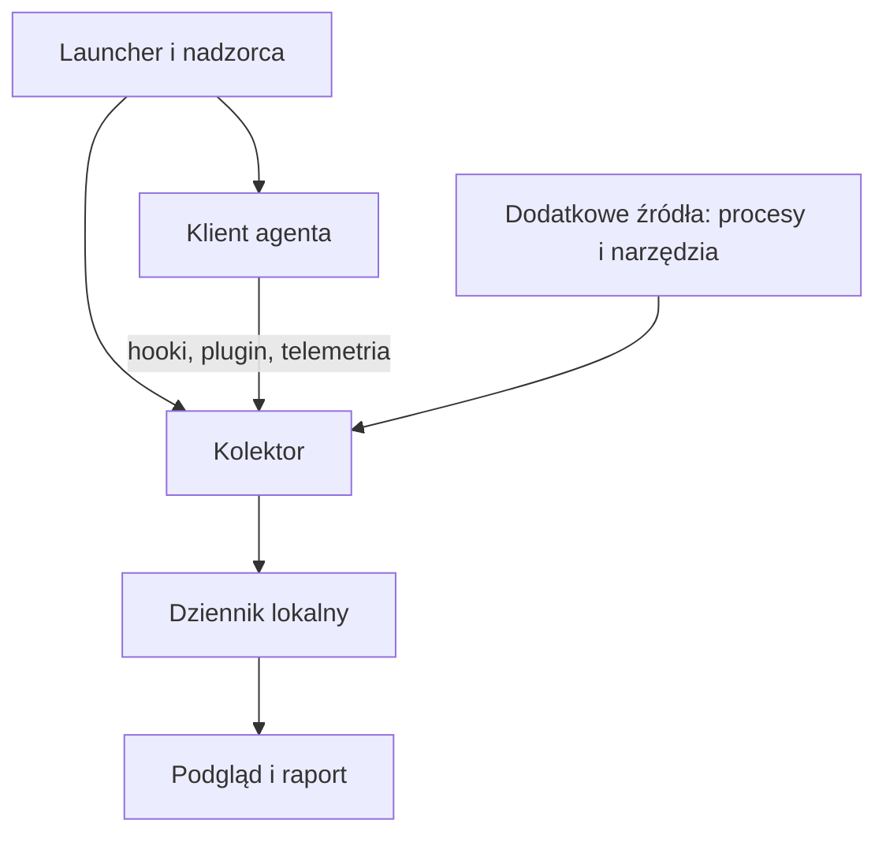

Stan analizy: 25 października 2026. System docelowy: Linux. Klienci: OpenCode, Codex i Claude Code. Dokument jest specyfikacją proponowanego rozwiązania dla agenta implementującego; opisane nowe komendy i moduły jeszcze nie istnieją.

# 1. Cel i decyzja architektoniczna

Użytkownik potrzebuje widzieć całą pracę agenta od uruchomienia do wyjścia: co obecnie trwa, jakie czynności już wykonano, gdzie wystąpił błąd i które odcinki zajęły najwięcej czasu. Widok musi obejmować inicjalizację, rozmowy i tury, żądania do modelu, narzędzia wbudowane, polecenia systemowe, podagentów, oczekiwanie na użytkownika lub zgodę, ponowienia, kompakcję i zakończenie. MCP jest jednym ze źródeł aktywności.

**Rekomendacja: najpierw sprawdzić AgentSight oraz integracje natywne; potem dopisać wyłącznie brakującą warstwę integracji.** Jeżeli gotowy produkt spełni kryteria MVP 0, wykorzystać jego zapis i podgląd. Poniższy własny kolektor oraz format zdarzeń są wariantem dla wykazanych braków, a nie obowiązkiem przebudowy działającego produktu.

Najmniejszy własny wariant:

- launcher obejmujący całe uruchomienie klienta;

- trzy adaptery jego natywnych zdarzeń;

- jeden lokalny zapis zdarzeń;

- podgląd live w drugim terminalu;

- później raport czasu, dodatkowa instrumentacja i interfejs [WWW](http://WWW).

Zakres „całej sesji” oznacza ciągłość obserwacji od początku do końca oraz jawne pokrycie poszczególnych rodzajów aktywności. Głębokość zależy od sygnałów udostępnianych przez klienta i narzędzie. Stan procesu „działa” nie dowodzi, że model aktualnie generuje odpowiedź; nazwa wywołania narzędzia nie ujawnia wszystkich jego instrukcji wewnętrznych.

Przywracanie zawartości plików pozostaje osobnym rozszerzeniem wymagającym wcześniejszych kopii, wersjonowania lub snapshotów. Dziennik operacji sam nie zapewnia odtworzenia usuniętych bajtów. Konto, grupa i sandbox mogą ograniczać skutki działań, ale nie dostarczają osi czasu i pomiarów będących celem tej roadmapy.

# 2. Ponowna weryfikacja gotowych rozwiązań

Wykonano analizę aktualnej dokumentacji i publicznych repozytoriów projektów. Nie instalowano produktów ani nie uruchamiano rzeczywistych sesji trzech klientów. „Kandydat” oznacza zatem rozwiązanie do sprawdzenia w MVP 0, a nie potwierdzoną zgodność z konkretną konfiguracją użytkownika.

| Rozwiązanie | Co można wykorzystać | Co wymaga sprawdzenia dla tego projektu | Decyzja |
| - | - | - | - |
| **AgentSight** | Lokalny podgląd TUI/WWW; obserwacja modeli, narzędzi, procesów, plików i sieci; obsługa trzech klientów; zapis SQLite | Pełna korelacja rozmów i podagentów, zgody, resume, widoczność operacji przed końcem, zgodność eBPF z systemem | Pierwszy kandydat do próby |
| **Langfuse** | Gotowe integracje OpenCode, Codex i Claude; historia sesji, ślady i analiza narzędzi | W integracjach Claude/Codex istotny zapis następuje po turze; nie wystarcza to do gwarancji prawdziwego live. Samodzielny hosting wymaga kilku usług | Dobry backend analityczny; ocenić koszt wdrożenia i opóźnienie |
| **AgentTrace** | Lokalna historia/TUI, porównanie klientów, czasy, koszty, błędy i jawne poziomy szczegółowości | Dokumentowany zapis kroków nie obejmuje treści promptów, wyników ani argumentów; kompletność live nie jest potwierdzona | Przydatny do historii; sprawdzić jako prostą alternatywę |
| **agentgateway** | Obserwacja przepływających żądań modelu i MCP, logi, metryki, ślady | Nie obejmuje samodzielnie pełnego życia klienta, lokalnych edycji i natywnej tożsamości rozmowy | Opcjonalna warstwa transportowa |
| **AgentOps** | SDK i integracje frameworków agentowych | Brak potwierdzonego gotowego pokrycia całego interaktywnego przebiegu wszystkich trzech CLI | Rozważyć przy własnym orkiestratorze |
| **ccflare** | Proxy Anthropic/OpenAI, historia i podgląd strumieni żądań | Ruch modelu opisuje komunikację; nie jest dowodem wykonania lokalnego narzędzia ani kompletnej obserwacji procesu | Dodatkowa diagnostyka modelu, gdy potrzebna |

Źródła: [AgentSight](https://github.com/eunomia-bpf/agentsight), [obsługiwani agenci AgentSight](https://github.com/eunomia-bpf/agentsight/blob/master/docs/agents.md), [Langfuse — Claude](https://langfuse.com/integrations/developer-tools/claude-code), [Codex](https://langfuse.com/integrations/developer-tools/codex), [OpenCode](https://langfuse.com/integrations/developer-tools/opencode), [self-hosting Langfuse](https://langfuse.com/self-hosting), [AgentTrace](https://github.com/luoyuctl/agenttrace), [agentgateway](https://agentgateway.dev/docs/standalone/latest/documentation/mcp/mcp-observability/), [AgentOps](https://github.com/AgentOps-AI/agentops), [ccflare](https://github.com/snipeship/ccflare).

Nie znaleziono potwierdzonego dokumentacją rozwiązania zapewniającego jednocześnie wszystkie wymagane szczegóły i live dla każdej konfiguracji tych trzech klientów. To uzasadnia **próbę integracji**, nie automatycznie budowę nowej platformy.

W AgentSight część obserwacji wykorzystuje uprawnienia do eBPF. Uprawnienia kolektora trzeba oddzielić od uprawnień agenta; dokumentowany launcher może uruchamiać agenta jako zwykłego użytkownika. Ocenić też tryb bez uprzywilejowanych sond i wyraźnie zapisać jego ograniczenia.

# 3. Wnioski z udostępnionego kodu

Analiza dotyczy przekazanego eksportu 44 plików. Brakuje m.in. pełnego Cargo.toml, Makefile, katalogu testów, wszystkich entrypointów, rejestru wersji MCP i plików Compose. Przed implementacją trzeba potwierdzić te elementy w pełnym checkoutcie. Poniższe ścieżki są względne wobec katalogu repozytorium.

| Miejsce | Ustalenie | Konsekwencja |
| - | - | - |
| `core/rust/src/profile_management/cli.rs` → `scoped.rs` | Produkcyjna ścieżka instalacji przechodzi przez `scoped::run`, `prepare` i `Prepared::commit` | Tu integrować instalowanie obserwatora i własnych wpisów konfiguracyjnych |
| `profile_management/installation.rs` | Historyczne `apply_profile` jest objęte `#[cfg(test)]`; helper `update_project_config` nadal działa w produkcyjnej ścieżce OpenCode | Nie rozbudowywać historycznego instalatora; wykorzystać potrzebne produkcyjne helpery konfiguracji |
| `profile_management/payload.rs::insert_native` | Repo dystrybuuje gotowe samodzielne binaria Rust | Nowy runtime może korzystać z tej ścieżki; uruchomienie w projekcie nie powinno wymagać Cargo ani checkoutu źródeł |
| `scoped.rs::Manifest::save` i rekordy klientów | Stan instalatora jest przebudowywany i obejmuje zarządzane pliki | Dzienniki, indeksy, sesje i sockety przechowywać poza manifestem i listą `files` |
| `process.rs::SystemProcessRunner::run` | Przechwytywanie używa odczytu do końca i zwraca wynik po zakończeniu | Obecny runner nie zapewnia live. Obejmuje też tylko procesy uruchamiane przez repo, nie wszystkie narzędzia klienta |
| `mcp/runtime.rs` | Typowa ścieżka kończy się `exec()`; identyfikacja obejmuje projekt i klienta | Adapter nie pozostaje nadzorcą i nie zna automatycznie native session ID |
| `mcp/config.rs` | Lokalne MCP przechodzą przez adapter; zdalne URL mogą go omijać. Lokalny argv jest walidowany jako `[adapter, SERVER]` | MCP nie może być głównym punktem obserwacji. Nie dopisywać dowolnych flag sesji do istniejącego kontraktu |
| `mcp/config.rs::load_local_at` | Lokalny format dopuszcza na najwyższym poziomie tylko `mcp` | Ustawienia obserwacji wymagają osobnego pliku albo jawnie wersjonowanej zmiany schematu |
| `mcp/novamira.rs` | Celowo usuwa `LOG_FILE`, ustawia `LOG_LEVEL=-1` i wycisza stderr upstream | Zachować ochronę danych; diagnostyczne żądania strażnika oznaczyć jako `origin=internal` |
| `wordpress/restore.rs` | Istnieje konwencja prywatnych danych w `XDG_STATE_HOME/ai-profiles` poza projektem | Dobry wzorzec dla lokalnej historii obserwacji |
| `layout.rs` i `profile_management/status.rs` | Układ `Isolated` oznacza układ plików; status instalacji nie potwierdza działania w sesji | Dodać osobny test aktywności adaptera; izolacji katalogów nie opisywać jako sandboxa OS |

Źródło: udostępniony eksport repozytorium, przede wszystkim powyższe moduły oraz `AGENTS.md` i `docs/testing.md`.

# 4. Jak ma wyglądać wynik dla użytkownika

Użytkownik uruchamia wybranego klienta zwykłym sposobem przez launcher obserwacji i zachowuje jego interaktywny terminal. W drugim terminalu albo późniejszym panelu widzi:

- aktywne uruchomienie, klienta, projekt, profil oraz wersję;

- rozmowy powiązane z uruchomieniem i bieżące tury;

- trwające czynności z nazwą, czasem i ostatnią aktualizacją;

- zakończone czynności z wynikiem, błędem i dostępnymi szczegółami;

- oczekiwanie na człowieka, ponowienie i kompakcję, gdy źródło je rozróżnia;

- podagentów z powiązaniem do rodzica;

- dostępność danych i odcinki, których nie udało się rozpoznać.

Przykładowy ekran tekstowy — dane ilustracyjne:

| Czas od startu | Źródło | Czynność | Stan |
| - | - | - | - |
| 0,0 s | launcher | Uruchomienie Codex, projekt A | zakończone |
| 1,1 s | klient | Tura 1: rozpoczęcie pracy | trwa |
| 1,4 s | telemetria klienta | Żądanie modelu, próba 1 | zakończone po 2,8 s |
| 4,3 s | narzędzie shell | Testy projektu | trwa od 17,2 s |
| 7,0 s | podagent | Analiza osobnego modułu | trwa od 14,5 s |
| 9,0 s | klient | Oczekiwanie na zgodę dla innej czynności | trwa od 12,5 s |

Widok pokazuje współbieżność. Nie sprowadza całego agenta do jednej etykiety „pracuje nad X”. Podgląd aktualizuje czas aktywnej operacji nawet wtedy, gdy źródło nie wysyła procentowego postępu.

Proponowany interfejs CLI do wdrożenia, dopasowywany w MVP 0 do istniejących nazw binariów:

```bash
ai-profile-observe run --client opencode --project /projects/example -- [argumenty klienta]
ai-profile-observe run --client codex --project /projects/example -- [argumenty klienta]
ai-profile-observe run --client claude --project /projects/example -- [argumenty klienta]

ai-profile-observe sessions
ai-profile-observe tail --run RUN_ID --follow
ai-profile-observe tail --session SESSION_KEY --follow
ai-profile-observe doctor --client codex --project /projects/example
ai-profile-observe report --session SESSION_KEY
```

Kwadratowe nawiasy powyżej są opisem argumentów, nie literalnym fragmentem polecenia. `report` należy do późniejszego etapu. Żadna z powyższych komend nie jest deklaracją istniejącego API repozytorium.

# 5. Wspólny model tożsamości i zdarzeń

## 5.1. Uruchomienie, rozmowa, tura i operacja

| Obiekt | Znaczenie | Reguła |
| - | - | - |
| `run_id` | Jedno uruchomienie nadzorowane przez launcher | Powstaje przed bootstrapem i spawn; obejmuje także nieudany spawn |
| `source_instance_id` | Konkretna instancja procesu/backendu/połączenia źródłowego | Rozróżnia restarty i liczniki zerowane po restarcie |
| `session_key` + `native_session_id` | Trwała rozmowa klienta w danej przestrzeni danych | Resume zachowuje tożsamość rozmowy; nowy run powstaje tylko przy nowym uruchomieniu klienta |
| `turn_id` | Jedna tura pracy związana z żądaniem użytkownika | Zakończenie tury nie kończy uruchomienia ani historii rozmowy |
| `operation_id` | Logiczna czynność: model, narzędzie, proces, oczekiwanie, kompakcja | Ma własny stan; identyfikator próby/requestu może być osobny |
| `parent_operation_id` i `links` | Relacje przyczynowe i inne powiązania | Zapisywać wyłącznie na podstawie identyfikatorów lub jawnego kontekstu |

Klucz rozmowy powinien zawierać klienta, stabilną przestrzeń jego danych/profil i natywny identyfikator. Sam PID, katalog projektu czy identyczny tekst promptu nie wystarczają. `source_instance_id` nie może być częścią trwałej tożsamości rozmowy, jeżeli rozdzielałby resume na różne sesje.

Relacja uruchomienie–rozmowa jest potencjalnie wiele-do-wielu: backend może obsługiwać wiele rozmów, a rozmowa może trwać przez kolejne uruchomienia. Launch frontend do istniejącego backendu nie jest ponowną inicjalizacją całego backendu. W MVP 1 można ograniczyć wspierany tryb do własnego, świeżo uruchomionego klienta/backendu; inne tryby muszą otrzymać jawny status ograniczonego pokrycia.

Zmienna środowiskowa `AI_PROFILES_RUN_ID` może przenosić tożsamość uruchomienia. Nie zastępuje natywnego identyfikatora aktualnej rozmowy. Nie stosować globalnego pliku „bieżąca sesja”.

## 5.2. Minimalna koperta zdarzenia

Propozycja schematu do zatwierdzenia przed implementacją:

```json
{
  "schema_version": 1,
  "event_id": "evt_unique",
  "kind": "operation.started",
  "run_id": "run_unique",
  "session_key": "codex:store_A:native_session_123",
  "turn_id": "turn_4",
  "operation_id": "tool_call_17",
  "parent_operation_id": null,
  "source": {
    "client": "codex",
    "client_version": "version_under_test",
    "adapter_version": "1",
    "instance_id": "source_process_9",
    "native_event_type": "PreToolUse",
    "native_event_id": null,
    "sequence": 41
  },
  "time": {
    "occurred_at": "2026-10-25T10:00:04.300Z",
    "received_at": "2026-10-25T10:00:04.312Z",
    "monotonic_ns": null,
    "clock_id": null,
    "duration_basis": "source_timestamp"
  },
  "operation": {
    "type": "tool",
    "name": "shell",
    "status": "running",
    "origin": "agent",
    "attributes": {
      "command_preview": "test command",
      "arguments_redacted": true
    }
  },
  "links": [],
  "coverage": {
    "start_observed": true,
    "correlation": "native"
  }
}
```

Pola powiązań mogą być puste przed utworzeniem rozmowy. `parent_operation_id` wskazuje wyłącznie istniejącą operację; powiązanie z turą zapewnia osobne `turn_id`. Identyfikatory muszą być przestrzenią nazw adaptera, a nie tylko krótkim numerem z upstream. Zachować oryginalny typ i dozwolone, zredagowane pola źródłowe, aby normalizacja nie usuwała informacji potrzebnych do diagnostyki. Osobno przechowywać `native_session_id` w metadanych rozmowy.

Wymagane rodziny zdarzeń:

- `run.started`, `run.spawned`, `run.spawn_failed`, `run.exited`;

- `session.linked`, `session.status_changed`;

- `turn.started`, `turn.finished`;

- `operation.started`, `operation.updated`, `operation.finished`;

- `artifact.created`;

- `coverage.changed`, `collector.warning`, `collector.stopped`.

Typy operacji obejmują `bootstrap`, `model_request`, `tool`, `process`, `permission_wait`, `user_wait`, `retry_backoff`, `compaction` i `subagent`. Nie każdy adapter musi od razu dostarczać każdy typ; zakres zapisuje deklaracja możliwości.

`operation.finished` rozróżnia `success`, `error`, `cancelled` i `timeout`. Brak końca pozostawia `incomplete/unknown`. Wyjście klienta z kodem 0 nie przepisuje wszystkich jego błędnych narzędzi na sukces.

## 5.3. Deklaracja pokrycia

Dla każdej pary wersja klienta–adapter zapisać osobno:

- obsługiwane rodzaje zdarzeń;

- czy początek jest dostępny przed końcem;

- dostępność natywnych identyfikatorów i rodzica;

- możliwość replay i zakres historii;

- dostępność stdout/stderr, argumentów i artefaktów;

- ograniczenia trybu interaktywnego, resume i wspólnego backendu.

W interfejsie rozróżniać: `observed`, `not_supported`, `not_enabled`, `redacted`, `dropped` i `unknown`. „Brak zdarzenia” nie może jednocześnie znaczyć „agent nic nie robił” i „adapter nie widzi tej czynności”.

# 6. Źródła dla trzech klientów

Źródła dobierać do wersji zainstalowanej w repo. Dokumentacja najnowszego wydania nie jest dowodem dostępności funkcji w używanym binarium.

| Klient | Podstawowe źródło live | Uzupełnienie | Warunek wdrożenia |
| - | - | - | - |
| OpenCode | Natywny plugin i zdarzenia sesji/narzędzi | API, dziennik sesji i strumienie wyjścia, zależnie od V1/V2 | Wykryć główną wersję; pluginy i konfiguracja V1/V2 różnią się |
| Codex | Hooki cyklu życia i narzędzi w obsługiwanej wersji | Natywna telemetria OTel; App Server tylko przy świadomej integracji tego sposobu uruchamiania | Sprawdzić zaufanie do pluginu/hooków, zakres zdarzeń i rzeczywiste identyfikatory |
| Claude Code | Hooki sesji, tur, narzędzi, błędów i podagentów | Natywna telemetria i tracing, według przypiętej wersji | Sprawdzić różnice sukces/błąd/przerwanie i powiązanie oczekiwania na zgodę |

**OpenCode.** V1 i V2 wymagają oddzielnie zweryfikowanych adapterów. V2 dokumentuje pluginy i eksperymentalny dziennik sesji z replay/follow; zwykłego live event streamu nie traktować jako gwarancji odtwarzania. Callback odpowiedzi HTTP może oznaczać otrzymanie nagłówków, a nie zakończenie strumienia modelu; transport WebSocket wymaga własnego pokrycia. Źródła: [V1 plugins](https://opencode.ai/docs/plugins/), [V2 plugins](https://opencode.ai/v2/docs/build/plugins), [migracja V1](https://opencode.ai/v2/docs/build/plugins/migrate-v1/), [V2 API](https://opencode.ai/v2/docs/api), [V2 client](https://opencode.ai/v2/docs/build/client).

**Codex.** Obecna dokumentacja obejmuje hooki sesji, promptów, narzędzi i podagentów. PostToolUse wymaga interpretacji wyniku: jego wystąpienie nie oznacza sukcesu polecenia. Pokrycie hooków nie obejmuje automatycznie każdego narzędzia hostowanego. Telemetria dostarcza dodatkowe sygnały żądań i wyników, lecz eksport może być buforowany. Konfiguracja OTel nie jest przyjmowana z projektowego `.codex/config.toml`; wybrać udokumentowany zakres użytkownika lub zweryfikowane ustawienia dla uruchomienia. App Server może dostarczać zdarzenia i delty wyjścia, ale nie zakładać przezroczystego podłączenia do dowolnej istniejącej sesji CLI. Źródła: [hooks](https://learn.chatgpt.com/docs/hooks), [konfiguracja zaawansowana](https://learn.chatgpt.com/docs/config-file/config-advanced), [App Server](https://learn.chatgpt.com/docs/app-server).

**Claude Code.** Rozróżniać PostToolUse od PostToolUseFailure. Dane PermissionRequest nie zawsze dostarczają identyfikatora pozwalającego przypisać oczekiwanie do konkretnego tool call; brakującego związku nie odtwarzać heurystycznie. Natywny tracing opisuje więcej etapów, lecz jest wersjonowaną funkcją beta. Licznik zdarzeń resetowany na proces nie jest globalnym numerem sesji po resume. Źródła: [hooks](https://code.claude.com/docs/en/hooks), [monitoring i tracing](https://code.claude.com/docs/en/monitoring-usage).

Hook obserwacji ma neutralną odpowiedź zgodną z kontraktem danego klienta. Nie zmienia argumentów, wyników, decyzji zgody ani treści rozmowy. Instalacja musi zachować istniejące hooki i przejść natywny mechanizm zaufania; status „plik zainstalowany” nie wystarcza do uznania integracji za aktywną.

Nie zastępować zwykłego trybu interaktywnego trybem headless tylko po to, aby uzyskać JSON. Import transcriptów to uzupełnienie historii; sam nie spełnia warunku widoczności trwającej czynności.

# 7. Lokalny przepływ i przechowywanie



W wariancie własnym kolektor uruchamia się przed klientem. Jeden writer porządkuje zapis; hooki i pluginy wysyłają zdarzenia prywatnym kanałem lokalnym. W MVP wystarczy proces związany z uruchomieniem i socket Unix. Nie potrzeba obowiązkowej usługi systemowej, brokera wiadomości ani bazy serwerowej.

Natywna telemetria wymaga odbiornika zgodnego z eksporterem danej wersji, np. OTLP/HTTP lub gRPC na loopback. Nie zakładać, że eksporter obsługuje własny socket Unix. Można użyć gotowego OTel Collectora. Adapter normalizuje rzeczywiście emitowany sygnał — log, event lub span — i zachowuje jego natywny kontekst.

Dane trwałe: `XDG_STATE_HOME/ai-profiles/observability/v1`, z fallbackiem `~/.local/state/ai-profiles/observability/v1`. Prywatne katalogi i pliki, walidowane identyfikatory w ścieżkach. Socket preferencyjnie w prywatnym katalogu `XDG_RUNTIME_DIR`; zapewnić kontrolowany fallback i sprawdzić limit długości ścieżki socketu.

Proponowany zapis:

| Ścieżka logiczna | Zawartość |
| - | - |
| `runs/RUN_ID/run.json` | Klient, wersja, projekt, profil, czas startu, końcowy status i deklaracja pokrycia |
| `runs/RUN_ID/events.jsonl` | Kanoniczny dziennik od startu launchera |
| `runs/RUN_ID/artifacts/` | Dozwolone załączniki albo metadane referencji |
| `sources/SOURCE_ID/events.jsonl` | Późniejszy wariant dla współdzielonego źródła, którego zdarzeń nie da się przypisać do jednego run |
| opcjonalny indeks SQLite | Przyspieszenie wyszukiwania, możliwe do odtworzenia z dzienników |

Zapis per run pozwala zachować bootstrap, zanim klient utworzy rozmowę. Widok i eksport per session składają właściwe zdarzenia ze wszystkich powiązanych uruchomień. Zdarzeń bootstrapu nie kopiować jako osobnych wykonań do każdej rozmowy. Referencje do uruchomień nie są dowodem bezpośredniej przyczynowości każdego zdarzenia.

Minimalne wymagania zapisu: pojedynczy poprawny JSON na rekord, jeden writer, ograniczony rozmiar komunikatu, obsługa urwanego ostatniego rekordu, sekwencja kolektora i jednoznaczna polityka flush. `fsync` na każdą deltę tekstu nie jest domyślnym wymaganiem; dokumentować możliwe okno utraty danych przy awarii systemu.

Podgląd live czyta ten sam dziennik lub strumień po zapisie, dzięki czemu historia i ekran korzystają z jednego modelu. Dla coarse events dopuszczalny jest krótki proces emitera hooka. Dla wielu fragmentów wyjścia użyć trwałego połączenia i batchowania; nie tworzyć procesu na każdy token.

Awaria obserwatora ma ograniczony wpływ na klienta: krótki timeout połączenia i zapisu, ograniczona kolejka, pojedynczy komunikat o degradacji. Limit czasu i wielkości dobrać pomiarem w MVP 1. Utraconych zdarzeń nie ukrywać; marker zapisać przy najbliższej możliwej okazji. Przy pełnym dysku nie obiecywać, że sam marker da się trwale zapisać.

# 8. Jak wiarygodnie wyjaśniać czas i błędy

Każdy pomiar powinien wskazywać podstawę: czas natywny, monotoniczny pomiar obserwatora albo oszacowanie. Czas UTC służy do prezentacji i łączenia historii; różnicę czasu obliczać z monotonicznego zegara tylko w tej samej domenie zegara. `received_at` nie jest zamiennikiem rzeczywistego początku zdarzenia.

| Pytanie | Potrzebne dowody | Poprawna interpretacja |
| - | - | - |
| Co teraz trwa? | Start bez końca, ewentualne aktualizacje | Lista aktywnych operacji i czas od zaobserwowanego startu |
| Dlaczego request modelu trwał długo? | Start, pierwszy fragment, koniec, próby i błędy | Czas do pierwszego fragmentu obejmuje transport i możliwe kolejki; nie oznacza czystego czasu obliczeń modelu |
| Ile trwało narzędzie? | Granice operacji i ewentualne fazy wewnętrzne | Rozdzielić zgodę, kolejkę i wykonanie tylko wtedy, gdy są ich sygnały |
| Co spowodowało błąd? | Wynik, exit code, wyjątek lub błąd transportu powiązany z operacją | Wskazać pierwszą udokumentowaną awarię i jej skutki; hipotezę przyczyny oznaczyć oddzielnie |
| Co zajęło sesję? | Przedziały udokumentowanych czynności | Pokazać wall time, nakładanie i czas nierozpoznany |
| Czy agent się zawiesił? | Ostatni sygnał, aktywna operacja, stan procesu/połączenia | „Brak aktualizacji od X” lub „przekroczony próg”, bez automatycznej diagnozy awarii |

Próby requestu mają własne identyfikatory i wyniki. Udane retry nie usuwa poprzedniego błędu. Oczekiwanie na zgodę, człowieka lub backoff jest odrębnym stanem, jeżeli źródło pozwala go ustalić.

Nie sumować długości współbieżnych spanów jako czasu całej sesji. Czas wyłączny rodzica wyznaczać przez odjęcie unii przedziałów dzieci w obrębie rodzica. Gdy dostępne są tylko ogólne granice tury, jej wnętrze pozostaje nierozpoznane. Model „zajęty” i shell „zajęty” mogą nakładać się przez podagentów.

Raport powinien zawierać:

- czas od uruchomienia do wyjścia oraz czas aktywnych tur;

- najdłuższe operacje z identyfikatorami i źródłami;

- błędy, anulowania, retry i oczekiwania;

- odcinki bez rozpoznanej aktywności;

- jakość pokrycia i ograniczenia danego pomiaru;

- odnośniki do surowego zredagowanego zdarzenia oraz artefaktu.

Nie wyliczać rankingu „najwolniejsze narzędzia” z samych histogramów agregowanych. Do przypisania konkretnego problemu potrzebne są zdarzenia lub spany konkretnego wywołania.

# 9. Roadmapa z etapami i kryteriami odbioru

## MVP 0 — wybór rozwiązania i sprawdzenie źródeł

**Cel:** potwierdzić możliwie dużo istniejącymi narzędziami, zanim powstanie własna warstwa.

Zadania:

1. Otworzyć pełne repo, przeczytać instrukcje i odtworzyć faktyczny lifecycle instalacji. Ustalić wersje trzech klientów, sposoby ich uruchamiania, pluginy, backendy i dostępność telemetrii.

2. W wymaganej VM sprawdzić AgentSight na każdym kliencie w zwykłym trybie interaktywnym. Sprawdzić natywne źródła i integracje Langfuse tam, gdzie mogą pokryć brakujące wymagania.

3. Wykonać wspólny scenariusz: start, dwie tury, długie polecenie, kontrolowany błąd, edycja pliku testowego, zakończenie i wznowienie. Dodać zgodę oraz podagenta, jeżeli wersja je obsługuje.

4. Zarejestrować dla każdej funkcji: dowód zdarzenia, identyfikator, czas pojawienia się, ograniczenia i wymagane uprawnienia.

5. Wydać decyzję `ADOPT`, `ADAPT` lub `BUILD` z wykazem konkretnych braków. Nie wymagać własnego formatu od gotowego produktu, jeżeli jego model spełnia potrzebę użytkownika.

**Warunek live:** polecenie trwające około 20 s musi być widoczne jako aktywne przed zakończeniem. Proponowany cel lokalnego opóźnienia to do 1 s od zdarzenia źródłowego; to kryterium do zmierzenia, nie wynik wykonanego benchmarku.

**Deliverables:** raport możliwości i wersji, zanonimizowane próbki zdarzeń, decyzja architektoniczna i lista luk. Brak klienta, dostępu do konta albo VM zapisuje się jako „niezweryfikowane”.

**Brama:** jeżeli gotowy produkt spełni wymagania, następny etap obejmuje jego instalację w profilach i brakujące integracje. Nie rozpoczynać automatycznie własnego kolektora ani dashboardu.

## MVP 1 — pełne granice uruchomienia i działający live dla trzech klientów

**Cel:** wykazać przepływ start → zdarzenia klienta → trwały zapis → live → koniec, przy minimalnej głębokości.

Małe PR-y:

| PR | Zakres | Zależność |
| - | - | - |
| 1A | Launcher, identyfikator run, kolektor, schema v1, JSONL, `tail` i metadata | MVP 0 |
| 1B | Adapter OpenCode dla używanej wersji | 1A |
| 1C | Adapter Codex | 1A |
| 1D | Adapter Claude Code | 1A |
| 1E | Dystrybucja binarium i własnych wpisów pluginów/hooków, `doctor` | Zweryfikowany kontrakt 1A–1D |

Adaptery można wdrażać równolegle po zatwierdzeniu kontraktu. Cały MVP 1 jest ukończony dopiero po sprawdzeniu trzech klientów.

W launcherze zapisać `run.started` przed przygotowaniem i spawn. Rozróżnić nieudany spawn od późniejszego błędu klienta. Nadzorca czeka na wyjście i zapisuje exit code lub sygnał; nie może zakończyć się własnym `exec` przed obserwowanym procesem.

`run.exited` opisuje rzeczywisty moment wyjścia klienta. Następnie kolektor przez ograniczony czas odbiera końcowe zdarzenia i opróżnia zaakceptowane kolejki, po czym zapisuje `collector.stopped`. Drenowanie nie przedłuża czasu pracy agenta. Przekroczenie limitu oznacza możliwą niekompletność; nie gwarantować odbioru eksportu, którego klient nigdy nie wysłał.

Zachować natywny terminal i stdin/stdout/stderr klienta. Początkowo dziedziczenie terminala jest prostsze od własnego PTY. Sprawdzić Ctrl-C, sygnały, resize i job control; nie zabijać grup procesów, których launcher nie utworzył i nie posiada.

Minimalny zakres adaptera: powiązanie natywnej rozmowy, początek/koniec tury, start/koniec narzędzia, wynik błędny, koniec uruchomienia. Szczegóły modelu mogą być jeszcze oznaczone jako niedostępne. Pierwszy widok ma już pokazywać rzeczywistą nazwę aktualnej czynności.

**Odbiór:** dla każdego klienta widać dwie tury, długą aktywną czynność przed końcem, kontrolowany błąd i poprawne zakończenie run. Ponowne otwarcie `tail` odtwarza stan z dziennika. Uruchomienie nie wymaga źródeł instalatora ani kompilatora. Własne logowanie nie pojawia się w stdout protokołu ani w kontekście modelu.

**Zakres MVP:** lokalny terminal i jeden nadzorowany klient/backend na run. Obsługę podłączania do już działającego wspólnego backendu można odłożyć, ale narzędzie musi rozpoznać ten przypadek i ujawnić ograniczenie, zamiast mieszać sesje.

## MVP 2 — wyjaśnienie czasu, błędów i postępu całej pracy

**Cel:** odpowiedzieć na „co trwało tak długo?” na podstawie zdarzeń konkretnej sesji.

Zadania:

1. Dodać natywne zdarzenia żądań modelu i próby tam, gdzie pozwala na to wersja. Wykorzystać dostępny OTel; nie wdrażać proxy modelu bez konkretnej luki.

2. Dodać zgody, oczekiwanie na człowieka, retry, backoff, kompakcję i podagentów. Nierozwiązywalne powiązania pozostawić jawnie nieprzypisane.

3. Zachować start live oddzielnie od końcowych spanów eksportowanych po czasie.

4. Dołożyć stdout/stderr z natywnego strumienia, jeśli istnieje, z byte cursorem lub źródłową sekwencją. Gdy źródło daje tylko wynik końcowy, oznaczyć to w możliwościach.

5. Wdrożyć raport z sekcji 8 i przejście od błędu do zdarzenia/artefaktu.

6. Mierzyć opóźnienie eksportu i koszt obserwatora; porównać scenariusz z obserwacją i bez niej.

**Odbiór:** scenariusz zawierający model, długie narzędzie, kontrolowany błąd/retry, zgodę oraz równoległego podagenta ma poprawne powiązania albo jawne braki. Raport nie dodaje współbieżnych czasów do wall time. Cisza źródła nie zostaje nazwana „myśleniem modelu”. Końcowy span dostarczony po turze nie jest uznawany za dowód live.

Jeżeli konkretny klient nie udostępnia części sygnałów, wynik etapu obejmuje zakres wspierany i udokumentowaną lukę. Nie uznawać tej luki za uzupełnioną przez syntetyczne zdarzenia.

## MVP 3 — codzienna niezawodność i wiele sesji

**Cel:** poprawna historia przy resume, równoległości i awariach.

Zadania:

- obsłużyć resume, dwa równoległe uruchomienia i kilka rozmów jednego backendu;

- dodać replay/reconnect oraz deduplikację na stabilnych identyfikatorach źródła, uwzględniając restart procesu;

- rozróżnić śmierć klienta, śmierć kolektora i utratę połączenia;

- obsłużyć brak startu, brak końca, duplikaty, zdarzenia poza kolejnością i ucięty ostatni rekord;

- ustalić limity rekordów, payloadów, kolejki, retencję i zachowanie przy pełnym dysku;

- sprawdzić install/update/uninstall oraz zachowanie cudzej konfiguracji i historii;

- dodać indeks tylko wtedy, gdy skanowanie dzienników staje się konkretnym problemem.

**Odbiór:** dwie rozmowy współdzielące backend nie mieszają narzędzi. Resume po ponownym uruchomieniu ma tę samą tożsamość rozmowy i nowy run; przełączenie rozmowy wewnątrz działającego klienta zachowuje run. Przerwany zapis nie produkuje fikcyjnego sukcesu. Awaria kolektora nie blokuje bezterminowo agenta. Usunięcie integracji nie usuwa historii bez osobnego polecenia użytkownika.

Podstawy odporności — pojedynczy writer, ograniczony komunikat, neutralne hooki i jawne niepełne zakończenie — obowiązują już w MVP 1. Ten etap rozszerza je o trudniejsze scenariusze użytkowe.

## MVP 4 — wygodny podgląd i integracje analityczne

**Cel:** codzienny ekran sesji bez budowania drugiego silnika zbierania danych.

Najpierw użyć istniejącego widoku wybranego produktu. Jeżeli nadal potrzebny jest własny panel, wystarczy lokalny serwer z listą uruchomień, osią czasu, aktywnymi operacjami, filtrami i szczegółami błędu. Panel czyta ten sam model co `tail` i `report`.

Wymagane funkcje: powrót do trwającej sesji, filtrowanie klient/projekt/rozmowa, odnośniki do podagentów i artefaktów, oznaczenie luk oraz eksport wybranej sesji. Zdarzenia przeglądarkowe powinny mieć kursor wznowienia. Renderować dane jako tekst; nie wykonywać treści logów.

Eksport do wybranego backendu OTel/Langfuse jest asynchroniczny i opcjonalny. Zachować lokalny zapis i kontrolę nad eksportowanymi polami. Backend śladów nie musi zapewniać bieżącego stanu otwartej operacji — sprawdzić to oddzielnie.

**Odbiór:** odświeżenie widoku zachowuje sesję i odtwarza aktywne operacje; wyłączenie zewnętrznego backendu nie usuwa lokalnej historii ani nie zatrzymuje klienta.

## MVP 5 — dodatkowa głębokość tam, gdzie rzeczywiście brakuje danych

**Cel:** wchodzić w szczegóły konkretnego wolnego narzędzia lub procesu.

Oddzielne, opcjonalne prace:

- streaming w `ProcessRunner` dla poleceń uruchamianych przez ai-profiles, z zachowaniem istniejącego capture używanego przez parsery;

- obserwacja procesów, plików i sieci przez gotowe sondy Linux, gdy brakuje danych natywnych;

- dodatkowa obserwacja granicy MCP, jeśli potrzebne są szczegóły transportu;

- referencje do trace przeglądarki, profili wykonania, logów testów i innych istniejących artefaktów;

- adapter przyszłego orkiestratora, który przekazuje jawne relacje rodzic–dziecko.

Każda praca musi odpowiadać na wskazaną lukę z realnej sesji. Rejestrowanie wywołania shell nie dowodzi obserwacji wszystkich operacji plikowych jego dzieci. Z kolei obserwacja syscalli nie odtwarza automatycznie semantyki tury, zgody czy podagenta.

**Odbiór:** wybrany przypadek awarii można prześledzić od run przez turę i narzędzie do rzeczywistego szczegółu źródłowego. Pozostałe czynności zachowują dotychczasowy poziom pokrycia i czytelne ograniczenia.

# 10. Szczegóły opcjonalnej obserwacji narzędzi

## Procesy i pliki

Natywne zdarzenie narzędzia jest pierwszym źródłem nazwy, parametrów, wyniku i związku z turą. Jeżeli potrzebna jest lista rzeczywistych procesów potomnych, odczytów i zapisów plików, trzeba dołożyć źródło systemowe i oznaczyć zakres jego obserwacji. Proces uruchomiony przez daemon, kontener lub zdalny host może nie należeć do lokalnego drzewa klienta.

W `process.rs` można dodać odczyt porcjami i sink zdarzeń, zachowując dotychczasowy bufor wyniku. Nie zmieniać zachowania wywołań parsujących stdout jako JSON lub SQL, np. w `wordpress/ddev.rs`. Ustalić limity i offsety bajtowe; fragmenty mogą przecinać znak UTF-8. Nie logować całego `CommandSpec` przez `Debug`, ponieważ może obejmować sekretne argv, env lub stdin.

Powiązanie zdarzenia plikowego z procesem jest dowodem poziomu OS. Powiązanie tego procesu z konkretnym narzędziem wymaga dodatkowego jawnego kontekstu. Zmiana zawartości pliku w czasie sesji nie jest samodzielnym dowodem, że wykonał ją agent.

## MCP

Obserwacja granicy protokołu daje nazwę serwera, `tools/call` i faktyczne narzędzie, zredagowane argumenty, czas, wynik oraz rozróżnienie błędu narzędzia, JSON-RPC i transportu. Nie ujawnia automatycznie wewnętrznych funkcji serwera.

Korelacja requestu wymaga co najmniej `connection_instance + direction + request_id`. ID JSON-RPC nie jest natywnym tool call ID. Dokładne przypisanie do rozmowy wymaga mostka w miejscu wysyłania requestu przez klienta. Bez niego zostawić zdarzenie na poziomie źródła/połączenia. Środowisko procesu ani podobieństwo argumentów nie zastępują tego mostka.

Obsłużyć wersję rzeczywiście wynegocjowaną przez klienta i serwer. Specyfikacja 2026-07-28 przewiduje m.in. `input_required` i kontynuację logicznej operacji przez następny request; nie każda odpowiedź kończy więc całą czynność. Progress jest opcjonalny: bez aktualizacji pokazywać upływ czasu, bez wymyślonego procentu. Źródła: [MCP Basic](https://modelcontextprotocol.io/specification/2026-07-28/basic), [Tools](https://modelcontextprotocol.io/specification/2026-07-28/server/tools), [Progress](https://modelcontextprotocol.io/specification/2026-07-28/basic/patterns/progress).

W tym repo ewentualny relay lokalnego MCP umieścić jako jawną ścieżkę w adapterze zewnętrznym. Wewnętrzne `exec` MariaDB lub Playwright mogą pozostać. Zdalny URL wymaga własnego źródła obserwacji albo gatewaya; nie zakładać, że przechodzi przez lokalny runtime. Zachować stdout wyłącznie dla protokołu i respektować tłumienie danych Novamira.

Jeżeli używany jest agentgateway, jego `mcp.session.id` traktować jako tożsamość połączenia MCP. To nie jest ID rozmowy agenta. Przepuszczenie ruchu przez gateway nie dodaje samoistnie natywnego rodzica. Źródło: [agentgateway MCP observability](https://agentgateway.dev/docs/standalone/latest/documentation/mcp/mcp-observability/).

## Playwright i Figma jako przykłady głębokości

Playwright MCP dokumentuje `browser_start_tracing` i `browser_stop_tracing` oraz gotowy Trace Viewer z akcjami, DOM, siecią, konsolą i timingiem. Włączyć tę możliwość dopiero po potwierdzeniu wersji serwera, capabilities i mapowania katalogu artefaktów. Powiązać trace z operacją/session, nie budować własnego debuggera przeglądarki. Trace nie oznacza śledzenia każdej instrukcji arbitralnego JavaScript. Źródło: [Playwright tracing](https://playwright.dev/mcp/tools/tracing).

Dla Figma można pokazać rzeczywiście wywołane narzędzia, np. `get_design_context` lub `get_screenshot`, wynik, błąd i czas. W sprawdzonej oficjalnej dokumentacji nie znaleziono publicznego kontraktu szczegółowych spanów wnętrza hostowanego serwera. Tę głębokość oznaczyć jako niedostępną, dopóki nie pojawi się instrumentacja źródłowa. Źródło: [Figma tools](https://developers.figma.com/docs/figma-mcp-server/tools-and-prompts/).

# 11. Plan zmian w repozytorium

Nazwy nowych modułów są propozycją. Agent implementujący powinien dopasować je do pełnego manifestu i konwencji projektu.

| Element | Proponowana odpowiedzialność |
| - | - |
| `core/rust/src/observability/model.rs` | Wersjonowana koperta, tożsamość, typy zdarzeń i pokrycie |
| `observability/runtime.rs` | Launcher, lifecycle kolektora, sygnały, konfiguracja uruchomienia |
| `observability/store.rs` | Jeden writer, JSONL, replay, limity i bezpieczne ścieżki |
| `observability/adapters/*` | Normalizacja zdarzeń Codex, Claude i OpenCode; tylko tyle plików, ile wymaga implementacja |
| `observability/report.rs` | Stan operacji, czasy, błędy i odwołania do dowodów |
| Nowy entrypoint/binarium | Proponowane `run`, `emit`, `tail`, `sessions`, `doctor`; później `report` i eksport |
| `profile_management/payload.rs` | Dystrybucja runtime i statycznych pluginów/hooków |
| `profile_management/scoped.rs` i natywna konfiguracja | Instalacja/aktualizacja wyłącznie własnych wpisów oraz zapis ownership |
| Osobny plik ustawień obserwacji | Tryb, limity, retencja, dozwolone pola i opcjonalny eksport |
| `process.rs` i `mcp/runtime.rs` | Późniejsze rozszerzenia odpowiadające konkretnym lukom |

JavaScript/TypeScript pluginu OpenCode może być statycznym payloadem. Nie wymuszać przepisywania jego natywnego API do Rust; wspólny runtime i normalizacja mogą nadal pozostać w Rust.

Metadane obserwacji ustawiać po złożeniu środowiska, jeżeli mają mieć zastrzeżoną semantykę. Nie pozwalać, aby projektowy dotenv przypadkiem podmienił identyfikator run lub adres kolektora. Przekazywanie kontekstu do kontenerów wymaga jawnej konfiguracji; samo ustawienie zmiennej na hoście tego nie zapewnia.

Zachować ownership cudzych hooków/pluginów. Aktualizacja plików runtime nie może usuwać historii; istniejący mechanizm atomowego zastępowania plików jest dobrym punktem wyjścia. Uninstall usuwa własną integrację, natomiast kasowanie historii stanowi osobną operację.

Przyszły orkiestrator powinien być producentem tego samego modelu zdarzeń, z jawnie przekazanymi relacjami rodzic–dziecko. Nie dodawać go automatycznie do `Client::ALL`, jeśli enum oznacza wspierane cele instalacji profilu.

# 12. Dane, błędy kolektora i poprawność korelacji

Minimalny tryb zapisu obejmuje metadane, nazwy narzędzi, statusy, czasy, bezpieczne ścieżki i kontrolowane podglądy argumentów. Pełne prompty, odpowiedzi, pliki i wyniki narzędzi mogą być potrzebne diagnostycznie; ich zapis włączać jako osobny tryb dla wybranej sesji z jawnymi limitami. Redakcję wykonywać przed trwałym zapisem i eksportem.

Nie przechwytywać całego środowiska, nagłówków autoryzacji, cookies ani celowo wyciszonych logów HTTP. Arbitrarny tekst może zawierać sekrety, których regex nie rozpozna; podstawową ochroną jest wybór dozwolonych pól, a nie sam filtr po zapisaniu pełnego payloadu.

Każdy rekord powinien wskazywać redakcję, ucięcie i referencję do większego artefaktu. Link do pliku wynikowego nie dowodzi jego trwałego istnienia po cleanup narzędzia; jeżeli ma być dostępny później, trzeba go jawnie zachować w dopuszczonym zakresie.

`event_id` powstaje przed wysłaniem i jest zachowywany przy ponownej próbie transportu. Natywna sekwencja jest opcjonalna; adapter nie może przedstawiać lokalnie nadanego numeru jako gwarantowanego upstream cursor. Kolektor prowadzi własny porządek zapisu, niezależny od porządku rzeczywistego wystąpienia zdarzeń.

Deduplikację transportu oddzielić od łączenia źródeł. Dla każdej operacji określić podstawowe źródło jej granic. Hook i span OTel tej samej czynności uzupełniają jedno wykonanie tylko wtedy, gdy łączy je wiarygodny natywny identyfikator lub kontekst trace. Bez tego zachować dodatkową telemetrię jako nieprzypisane dane źródłowe; nie doliczać jej jako drugiego wykonania ani nie sklejać po nazwie i czasie.

Korekta stanu po spóźnionym zdarzeniu ma być deterministyczna. Koniec bez zaobserwowanego startu może utworzyć operację z niepełnymi granicami, ale nie wolno dorabiać startu o precyzji, której źródło nie zapewnia. Replay nie dubluje zakończonych operacji.

Przy dołączeniu do działającego klienta oznaczyć obserwację częściową i czas dołączenia. Brak `SessionEnd` nie jest automatycznie crashem; brak `run.exited` po awarii nadzorcy pozostawia status niepełny. Użytkownik musi widzieć różnicę między zakończeniem klienta a utratą samej telemetrii.

# 13. Weryfikacja i testy akceptacyjne

Przed implementacją przeczytać pełne `AGENTS.md` i `docs/testing.md`. Użyć wymaganego `test-gap-discovery`, jeśli skill jest dostępny; przy braku odnotować niedostępność i zastosować opisaną w repo metodykę. W katalogu umiejętności tej sesji skill nie był dostępny.

W przekazanym `docs/testing.md` testy Rust/Playwright wymagają rzeczywistej VM Incus QEMU/KVM z Debian 13 Trixie amd64. Nie zastępować tej bramy testami uruchamianymi na hoście, Dockerem ani atrapą środowiska. Dokumentacja wskazuje `make validate-rust-migration`, a dla zmian orkiestracji VM także `bash tests/vm/check.sh` i `make test-all`. Pełny checkout musi potwierdzić istnienie i właściwy zakres tych komend.

Stosować projektowy cykl: wymaganie → niezależny scenariusz negatywny → RED → minimalna implementacja → GREEN. Nie pisać testów odwzorowujących jedynie ten sam kod normalizacji. Rejestrowanie testów sprawdzić w rzeczywistym Cargo.toml i module biblioteki; eksport nie zawiera całego manifestu.

| ID | Scenariusz | Oczekiwany dowód |
| - | - | - |
| T01 | Zwykły interaktywny start i wyjście każdego klienta | Start przed spawn, natywne zdarzenia, właściwy exit code/sygnał, opróżnienie końcowych zdarzeń |
| T02 | Brak binarium klienta | `run.spawn_failed`; brak fikcyjnej rozpoczętej rozmowy |
| T03 | Długa czynność | Widoczna jako aktywna przed zakończeniem; zmierzona latencja live |
| T04 | Dwie tury i kontrolowany nonzero exit | Osobne tury; błąd narzędzia zachowany mimo dalszej poprawnej pracy |
| T05 | Resume po ponownym uruchomieniu; osobno zmiana rozmowy bez restartu | Trwała tożsamość rozmowy; nowy run tylko po nowym uruchomieniu; brak duplikowania historii |
| T06 | Dwie rozmowy wspólnego backendu | Brak krzyżowego przypisywania operacji; brak mapowania ujawniony |
| T07 | Podagent i czynność równoległa | Jawne relacje; poprawny wall time bez sumowania nakładania |
| T08 | Zgoda, retry, kompakcja | Właściwe fazy tam, gdzie źródło je udostępnia; luki jawne |
| T09 | Utrata kolektora, restart podglądu i spóźniony eksport końcowy | Klient zachowuje działanie; niepełne pokrycie i replay; ograniczone drenowanie po wyjściu |
| T10 | SIGINT/SIGTERM, awaria i SIGKILL | Bez fikcyjnego sukcesu; poprawne zachowanie terminala i własności procesu |
| T11 | Duplikaty, reorder, brak startu/końca, urwany JSONL | Deterministyczny stan i oznaczone braki |
| T12 | Pełny dysk, zbyt duży payload, zerwane połączenie | Ograniczone oczekiwanie/pamięć; widoczna degradacja, jeśli da się ją przekazać |
| T13 | Dane wrażliwe w argumentach i wyniku | Redakcja przed zapisem; zachowanie wyciszenia Novamira |
| T14 | Install/update/uninstall z istniejącymi hookami | Zachowanie cudzych wpisów, własnego ownership i historii |
| T15 | Runtime w projekcie bez checkoutu źródeł | Brak zależności od Cargo i source-only `RepositoryContext` |
| T16 | Opcjonalne MCP i artefakty | Poprawna korelacja lub jawny brak; czysty stdout; rzeczywiście dostępny trace |

Dobór testów ograniczyć do konkretnego zakresu PR. T01–T04, T15 i podstawy T09–T14 są bramą MVP 1; pozostałe rosną wraz z funkcjami. Nie rozszerzać testowania bez końca po spełnieniu wymaganej bramy.

Próbki z rzeczywistych klientów mogą posłużyć do testów regresji parsera po redakcji. Same próbki i mocki nie dowodzą, że hook został aktywowany w normalnej sesji. Testy wymagające konta lub dostępu do realnej usługi oznaczyć jako niewykonane, jeśli brak warunków; nie zastępować tego statusem PASS.

# 14. Kolejność wykonania dla agenta implementującego

1. Zacznij od MVP 0. Przeczytaj pełne instrukcje repo i zapisz wersje klientów. Potwierdź, czy zwykły tryb użytkownika uruchamia nowy backend, czy łączy się z istniejącym.

2. Przetestuj gotowe narzędzia tym samym scenariuszem dla wszystkich trzech klientów. Zapisz rzeczywiste opóźnienie pierwszego zdarzenia i pokrycie granic uruchomienia.

3. Podejmij udokumentowaną decyzję ADOPT/ADAPT/BUILD. Własny kod uzasadnij konkretną luką, a nie ogólną preferencją architektoniczną.

4. Dla wariantu BUILD zatwierdź tożsamość, format v1, politykę danych i krótkie limity emitera. Wdrożenie zacznij od jednego kompletnego przepływu, następnie dołącz pozostałe adaptery.

5. Zachowaj zwykły terminal, native IDs i rozdzielenie run/session. Nie zmieniaj ustawień uprawnień agenta tylko po to, aby uprościć zbieranie danych.

6. Każdy PR zakończ dowodem działania i listą ograniczeń. Weryfikuj według wymaganego środowiska projektu.

7. Po MVP 1 pokaż działający live na trzech klientach. Po MVP 2 pokaż analizę jednej wolnej/błędnej sesji wraz ze źródłami wniosków.

8. Rozszerzenia systemowe, MCP i interfejs WWW wdrażaj zgodnie z kolejnością etapów albo po wykazaniu konkretnej potrzeby. Zachowaj jeden model danych i jeden zapis kanoniczny.

**Definicja ukończenia podstawowego celu:** użytkownik może uruchomić każdy z trzech klientów, obserwować bieżące czynności podczas normalnej pracy, wrócić do historii po wyjściu i wskazać udokumentowane źródło czasu/błędu wraz z jawnie opisanymi brakami. Szczegół, którego klient lub narzędzie nie ujawnia, pozostaje oznaczony jako niedostępny.

# 15. Źródła i status ustaleń

Analiza repozytorium jest statyczna i dotyczy eksportu udostępnionego w rozmowie. Nie wykonano zmian w kodzie projektu, instalacji produktów ani testów klientów. Nowe nazwy modułów, komend, zdarzeń, progi opóźnień oraz etapy są propozycją projektu.

Źródła produktu, integracji i protokołu są podlinkowane bezpośrednio przy odpowiednich twierdzeniach w sekcjach 2, 6 i 10. Zostały sprawdzone 25 października 2026. Agent implementujący powinien ponownie porównać je z przypiętymi wersjami przed wdrożeniem, szczególnie dla pluginów OpenCode V1/V2, hooków Codex, tracingu Claude i MCP.

Dokument celowo nie narzuca terminów w dniach przed próbą MVP 0. Nakład zależy przede wszystkim od rzeczywistego pokrycia gotowego produktu i wersji klientów, a nie od samej liczby ekranów czy plików adaptera.
